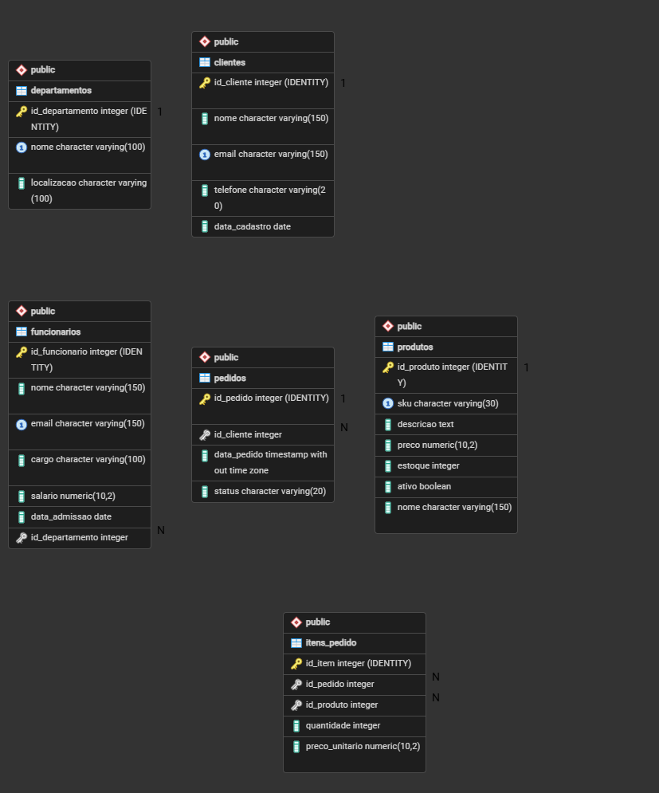

# Sistema Empresarial com PostgreSQL

Projeto de banco de dados relacional desenvolvido com **PostgreSQL, SQL e PL/pgSQL**, simulando o gerenciamento de informações empresariais, incluindo funcionários, departamentos, clientes, produtos, pedidos e controle de estoque.

O projeto foi desenvolvido para aplicar conceitos de modelagem relacional, integridade de dados, consultas analíticas, transações e programação em banco de dados.

## Tecnologias utilizadas

- **PostgreSQL 18:** gerenciamento do banco de dados relacional.
- **pgAdmin 4:** administração e execução de consultas.
- **SQL:** definição, manipulação e consulta de dados.
- **PL/pgSQL:** implementação de funções e procedimentos armazenados.
- **GitHub:** versionamento e documentação do projeto.

## Estrutura do projeto

```text
sistema-empresarial-postgresql/
│
├── docs/
│   └── diagrama_er.png
│
├── sql/
│   ├── 01_schema.sql
│   ├── 02_dados_exemplo.sql
│   └── 03_consultas.sql
│
├── README.md
└── .gitignore
```

### Descrição dos arquivos

| Arquivo | Descrição |
|---|---|
| `01_schema.sql` | Estrutura das tabelas, relacionamentos, restrições, índices, VIEW e rotinas |
| `02_dados_exemplo.sql` | Inserção de dados fictícios |
| `03_consultas.sql` | Consultas SQL para análise de dados |
| `diagrama_er.png` | Representação visual da estrutura relacional |

## Modelagem do banco de dados

O banco possui seis tabelas:

| Tabela | Finalidade |
|---|---|
| departamentos | Cadastro dos departamentos empresariais |
| funcionarios | Informações dos funcionários |
| clientes | Cadastro de clientes |
| produtos | Catálogo de produtos e controle de estoque |
| pedidos | Registro de pedidos e seus status |
| itens_pedido | Produtos e quantidades associados aos pedidos |

### Relacionamentos

- **Departamentos → Funcionários:** 1:N
- **Clientes → Pedidos:** 1:N
- **Pedidos → Itens do pedido:** 1:N
- **Produtos → Itens do pedido:** 1:N

A tabela `itens_pedido` representa a associação entre pedidos e produtos, permitindo que um pedido contenha vários produtos e um produto participe de diferentes pedidos.

## Diagrama Entidade-Relacionamento



## Funcionalidades implementadas

### Modelagem e integridade

- Criação de tabelas relacionais.
- Chaves primárias e estrangeiras.
- Restrições `NOT NULL`, `UNIQUE` e `CHECK`.
- Relacionamentos com integridade referencial.
- Identificadores gerados automaticamente.

### Consultas SQL

- `INNER JOIN` e `LEFT JOIN`.
- `GROUP BY`, `SUM()`, `COUNT()` e `AVG()`.
- Subconsultas.
- CTEs com `WITH`.
- Window Functions.
- Rankings e análises de vendas.
- Consultas relacionadas a funcionários, produtos e estoque.

### Recursos do PostgreSQL

**VIEW — `vw_resumo_pedidos`**

Consulta reutilizável que apresenta informações dos pedidos, incluindo cliente, status e valor total.

**FUNCTION — `calcular_total_pedido()`**

Calcula o valor total de um pedido a partir de seu identificador.

**PROCEDURE — `atualizar_status_pedido()`**

Atualiza o status de pedidos, validando as transições permitidas.

**Índices**

Índices criados para auxiliar consultas envolvendo clientes, pedidos e produtos.

**Transações**

Aplicação de `BEGIN`, `COMMIT` e `ROLLBACK` para demonstrar operações controladas e consistência dos dados.

O projeto inclui um exercício de atualização de estoque por transação. A baixa automática de estoque ainda não está implementada como uma funcionalidade integrada.

## Exemplos de consultas

### Consultar o resumo dos pedidos

```sql
SELECT *
FROM vw_resumo_pedidos
ORDER BY id_pedido;
```

### Consultar vendas confirmadas

```sql
SELECT
    cliente,
    SUM(valor_total) AS total_gasto
FROM vw_resumo_pedidos
WHERE status IN ('PAGO', 'ENVIADO')
GROUP BY cliente
ORDER BY total_gasto DESC;
```

### Calcular o total de um pedido

```sql
SELECT calcular_total_pedido(1);
```

Outros exemplos, incluindo CTEs, subconsultas e funções de janela, estão disponíveis em `sql/03_consultas.sql`.

## Como executar o projeto

### Pré-requisitos

- PostgreSQL 18
- pgAdmin 4 ou cliente compatível
- Acesso à ferramenta `psql` para executar o script de estrutura

### Passo 1 — Criar o banco de dados

Crie um banco vazio chamado `empresa_teste`, utilizando o pgAdmin.

### Passo 2 — Restaurar a estrutura

O arquivo `01_schema.sql` foi gerado pelo `pg_dump` no formato Plain e contém comandos específicos do `psql`.

Na pasta principal do projeto, execute:

```bash
psql -U postgres -d empresa_teste -f sql/01_schema.sql
```

Também é possível utilizar a opção **Restore**, com formato **Plain**, no pgAdmin.

### Passo 3 — Inserir os dados fictícios

```bash
psql -U postgres -d empresa_teste -f sql/02_dados_exemplo.sql
```

Esse script deve ser executado apenas uma vez em um banco recém-criado, para evitar duplicação de registros.

### Passo 4 — Executar as consultas

```bash
psql -U postgres -d empresa_teste -f sql/03_consultas.sql
```

As consultas também podem ser executadas individualmente no Query Tool do pgAdmin.

## Validação

A estrutura do banco e o script de dados fictícios foram testados em um ambiente separado, verificando a criação das tabelas e a inserção dos registros.

As consultas SQL foram executadas e validadas utilizando os dados de exemplo.

## Possíveis evoluções

- Integração com API REST utilizando Python e FastAPI.
- Automatização do processamento de pedidos e movimentação de estoque.
- Desenvolvimento de pipeline ETL.
- Construção de dashboards no Power BI.
- Implementação de testes automatizados.

## Autor

**Alexandre Barros Santana**

Estudante de Análise e Desenvolvimento de Sistemas.

[LinkedIn](https://www.linkedin.com/in/alexandre-barros-santana/) | [GitHub](https://github.com/Alexandrebsantana)

## Autor

Alexandre Barros Santana  
[LinkedIn](https://www.linkedin.com/in/alexandre-barros-santana/)  
[GitHub](https://github.com/Alexandrebsantana)
